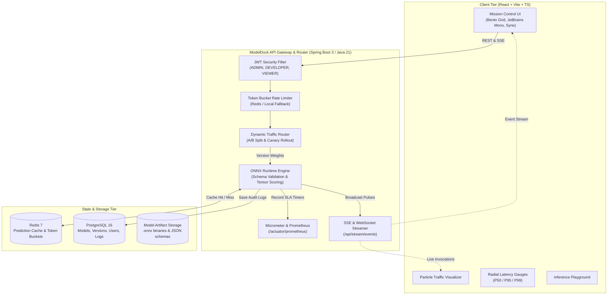

# ModelDock 🛰️

> **Mission Control for ML Models** — High-Performance Model Serving, Canary Rollouts, and Dynamic A/B Traffic Routing Platform.

ModelDock is a full-stack ML model serving platform designed with a mission-control aesthetic: dark graphite surfaces, electric acid-lime accents, asymmetric bento grids, radial latency gauges, live particle flow pipelines, and real-time telemetry streaming.

---

## 🏛️ Architecture Overview



---

## 🚀 Key Features

### 1. Backend (Java 21, Spring Boot 3.4+)
- **JWT Role-Based Access Control**:
  - `ROLE_ADMIN`: Full system control, delete models, manage infrastructure.
  - `ROLE_DEVELOPER`: Upload ONNX models, update canary weights, test endpoints.
  - `ROLE_VIEWER`: Telemetry inspection, audit logs, playground testing.
- **Model Registry & Versioning**:
  - Multipart `.onnx` binary upload with SHA/MD5 hashing.
  - Strict JSON schema input validation (`properties`, `required` fields).
  - Version lineage tracking (`ACTIVE`, `CANARY`, `STAGING`, `ARCHIVED`).
- **Dynamic Traffic Routing**:
  - `POST /predict/{model}` routes dynamically via weighted A/B split or Canary rollout.
  - `POST /predict/{model}/{version}` directly routes to a pinned version.
- **Redis Acceleration & Rate Limiting**:
  - In-memory/Redis token bucket rate limiter (120 req capacity, 30 ref/sec).
  - Prediction result caching with MD5 hash keys and sub-millisecond return.
- **Micrometer & Prometheus Observability**:
  - P50, P95, and P99 SLA percentiles published via histogram timers.
  - Actuator metrics available at `/actuator/prometheus`.
- **Real-Time Telemetry Stream**:
  - Server-Sent Events (SSE) at `/api/stream/events` and WebSocket STOMP at `/ws`.

### 2. Frontend (React 19, Vite, TypeScript)
- **Distinctive Visual Aesthetic**:
  - Concept: **"Mission control for models"**
  - Dark graphite base (`#07080a`, `#0e1117`), electric acid lime (`#ccff00`), and cyber cyan (`#38bdf8`).
  - Typography: **Syne** & **Space Grotesk** display paired with **JetBrains Mono** data font.
- **Custom Visual Components**:
  - **Radial Latency Gauges**: SVG dials with real-time P50, P95, and P99 tick markers.
  - **Sparkline-in-Cell**: Inline SVG micro charts for throughput and error trends.
  - **Particle Traffic Visualizer**: Interactive HTML5 Canvas showing packets moving along Bézier curves according to A/B split weights.
  - **Top Status Ticker**: Mission clock, cluster nominal status, and live event ticker tape.
- **6 Complete Modules**:
  1. `Command Center`: Live traffic, latency, and error gauges updating in real time.
  2. `Model Registry`: Version timeline per model, status badges, and upload modal.
  3. `Traffic Lab`: Drag sliders to shift A/B or canary traffic with instant visual feedback.
  4. `Playground`: Send test inputs, view predictions, latency, confidence, and answering version.
  5. `Logs & Alerts`: Filterable request history with JSON trace inspection drawer.
  6. `Auth Screens`: Instant 1-click test role logins and JWT token registration.

---

## 🔑 Default Credentials (Seed Data)

| Role | Username / Email | Password | Permissions |
| :--- | :--- | :--- | :--- |
| **Admin** | `admin` / `admin@modeldock.io` | `admin123` | Full Cluster Access |
| **Developer** | `developer` / `dev@modeldock.io` | `dev123` | Deploy Models & Routes |
| **Viewer** | `viewer` / `viewer@modeldock.io` | `viewer123` | Read-only Telemetry |

---

## 📦 Pre-loaded Models & Canary Routes

1. **`churn-predictor`** (Customer Attrition Risk):
   - `v1.0.0` (80% traffic): Logistic Regression baseline.
   - `v2.0.0` (20% traffic): Gradient Boosted Ensemble with sub-10ms target.
   - Route Strategy: `AB_SPLIT (80% / 20%)`

2. **`sentiment-analyzer`** (Real-Time NLP polarity):
   - `v1.0.0` (90% traffic): FastText embedding classifier.
   - `v1.1.0` (10% traffic): DistilBERT ONNX quantized canary rollout.
   - Route Strategy: `CANARY (90% / 10%)`

3. **`fraud-detection`** (Transactional Anomaly Scoring):
   - `v1.0.0` (100% traffic): Deep neural network anomaly detector.
   - Route Strategy: `SINGLE (100%)`

---

## 🛠️ Quick Start

### Option A: Docker Compose (All-in-One)

```bash
docker compose up --build
```

- **Frontend Dashboard**: `http://localhost:80` (or `http://localhost:5173` in dev)
- **Backend API**: `http://localhost:8080`
- **OpenAPI / Swagger UI**: `http://localhost:8080/swagger-ui.html`
- **Prometheus Telemetry**: `http://localhost:8080/actuator/prometheus`

### Option B: Local Development

#### 1. Backend (Java 21, Spring Boot 3)
```bash
cd backend
mvn clean spring-boot:run
```
*(Runs with built-in H2 fallback if PostgreSQL/Redis are not running locally).*

#### 2. Frontend (React, Vite, TypeScript)
```bash
cd frontend
npm install
npm run dev
```
Open [http://localhost:5173](http://localhost:5173) in your browser.

---

## 📖 API Documentation (OpenAPI 3)

| Method | Endpoint | Description | Auth |
| :--- | :--- | :--- | :--- |
| `POST` | `/api/auth/login` | Authenticate user and receive JWT token | Public |
| `POST` | `/api/auth/register` | Register new engineer account | Public |
| `GET` | `/api/models` | List all models and their version schemas | Public |
| `POST` | `/api/models` | Deploy or register model version | Developer / Admin |
| `POST` | `/api/models/{name}/versions/{v}/upload` | Upload `.onnx` binary artifact | Developer / Admin |
| `POST` | `/predict/{model}` | Predict via dynamic A/B or canary route | Public (Rate Limited) |
| `POST` | `/predict/{model}/{version}` | Predict directly against specific version | Public (Rate Limited) |
| `GET` | `/api/traffic/routes` | Get all active traffic split routes | Public |
| `PUT` | `/api/traffic/routes/{model}` | Update traffic split percentage weights | Developer / Admin |
| `GET` | `/api/logs` | Paginated, filterable inference request logs | Public |
| `GET` | `/api/stream/events` | SSE live stream of inference events | Public |
| `GET` | `/api/metrics/summary` | Telemetry summary: P50/P95/P99 latency, RPS | Public |

Interactive Swagger documentation is available at `http://localhost:8080/swagger-ui.html`.

---

## 🧪 Testing

```bash
# Frontend Unit & Type Checking
cd frontend && npm run build

# Backend Test Suite
cd backend && mvn test
```

---

## 📄 License
Apache 2.0 © 2026 ModelDock Core Team.
